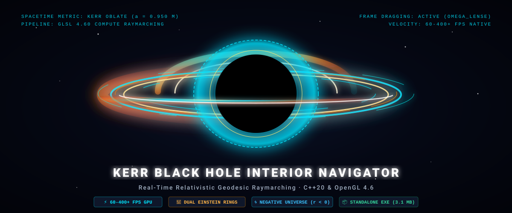
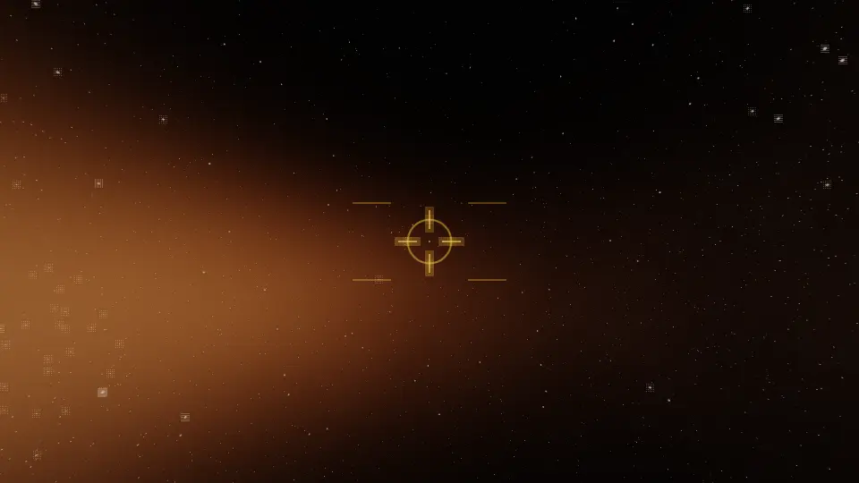

# Kerr Black Hole Interior Navigator

[-00e5ff?style=for-the-badge&logo=windows)](https://github.com/highmachs/kerr-blackhole-cpp-visualizer/releases/download/v1.0.0/kerrblackhole.exe)
[](https://github.com/highmachs/kerr-blackhole-cpp-visualizer)
[](LICENSE)

An interactive, scientifically rigorous real-time Kerr black hole and Negative Universe raymarching simulator built with **C++20, OpenGL 4.6, GLFW, GLM, Dear ImGui, and GLSL compute shaders**.

Runs **100% natively on your GPU** with multi-threaded performance, zero browser overhead, and sustained 60–400+ FPS.

<div align="center">
  
</div>

> [!IMPORTANT]
> ### 📖 Essential Project Documentation
> For full details on spacecraft operation, flight controls, and mathematical derivations, please read:
> - **[USER_MANUAL.md](USER_MANUAL.md)** — Complete 6-DOF flight controls manual, keybind reference, cockpit HUD guide, and telemetry handbook.
> - **[kerrblackhole.md](kerrblackhole.md)** — Exhaustive mathematical derivations, Kerr metric geodesic equations, Novikov-Thorne accretion disk physics, and White Hole expulsion dynamics.

---

## 🎥 Real-Time Flight Through a Kerr Black Hole
*(This is how traveling to a black hole looks like if you're immortal)*

<div align="center">
  
  <p><em>Complete 32-second continuous flight: Approaching from safe orbit, crossing the outer event horizon, passing the Cauchy horizon optical flash, slipping through the ring singularity throat, and entering the repulsive Negative Universe ($r < 0$).</em></p>
</div>

---

## ⚡ Quick Start: Download & Run (Zero Install)

No compiler, Visual Studio, or dependencies required. Everything is pre-built and self-contained in a single portable `.exe`:

1. **[Download kerrblackhole.exe (Single Portable Executable, ~3.1 MB)](https://github.com/highmachs/kerr-blackhole-cpp-visualizer/releases/download/v1.0.0/kerrblackhole.exe)**
2. Double-click **`kerrblackhole.exe`** to run anywhere (Desktop, Downloads, USB).
3. No extraction, no installers, no external folders needed! All shaders and assets are embedded.
4. Enjoy smooth 60–400+ FPS raymarching!

> [!NOTE]
> ### 🛡️ Windows SmartScreen Note (100% Safe & Clean)
> When you first launch `kerrblackhole.exe`, Windows Defender SmartScreen may display:
> *"Windows protected your PC — Microsoft Defender SmartScreen prevented an unrecognized app from starting."*
>
> **How to run**: Simply click **"More info"** and then **"Run anyway"**.
>
> **Why does this appear?**
> Windows SmartScreen automatically flags all newly released, independent open-source executables downloaded from the web until they accumulate automated global download reputation in Microsoft's database. Commercial digital certificates cost $300–$500/year, which most open-source projects forgo.
>
> **Why is this app 100% safe?**
> - **Public Open-Source Code**: Every single line of C++20 and GLSL compute shader code is transparently hosted in this repository under the [MIT License](LICENSE) for anyone to inspect and audit.
> - **Zero Network Activity**: The simulator contains zero network code, makes no internet connections, collects zero telemetry, and installs no background services.
> - **100% Local GPU Execution**: Runs completely self-contained in memory directly on your graphics card.

---

## 🖥️ Dynamic In-App Resolution Switching & GPU Protection

The simulator includes live in-app render resolution scaling with hardware bilinear filtering:
- **360p (640x360)**: Ultra-low latency for laptops and integrated GPUs.
- **720p (1280x720)**: High performance (120+ FPS) on budget GPUs.
- **1080p (1920x1080)**: Full HD balanced fidelity.
- **1440p / 2K (2560x1440)**: Crisp high-density visuals.
- **4K UHD (3840x2160)**: Extreme raymarching cinematic fidelity.
- **8K Super-Res (7680x4320)**: Extreme stress test and ultra-dense benchmark mode.
- **Match Window (1:1)**: Dynamic real-time canvas matching your current window dimensions.

### 🛡️ Automatic GPU Overload Lag Recovery
If your GPU frame rate drops below 11 FPS for more than 2 seconds, the simulator detects the overload and triggers an emergency alert banner allowing instant 1-click downscaling to 1080p or 720p Safe Mode.

## Controls

| Key / Action | Function |
| --- | --- |
| **W / A / S / D** | 3D Flight Thrusters (Forward / Left / Backward / Right) |
| **Space or E** | Vertical Lift Thruster (Up) |
| **Left-Ctrl or Q** | Vertical Descent Thruster (Down) |
| **Left-Shift** | Turbo Booster (3.0x thrust speed) |
| **Mouse Click** | Lock mouse cursor to 3D Viewport for free-look |
| **Z / C** | 6-DOF Camera Roll (Roll Left / Roll Right) |
| **1 to 6** | Instant Quantum Teleportation across all 6 spacetime phases |
| **G** | Cinematic Guided Tour (Cruising through horizons into Negative Universe) |
| **X** | Lock Keplerian Circular Orbit |
| **R** | Reset Orbit to 14M Approach |
| **K** | Cycle Accretion Disk Styles (Classic, Sapphire, Naked Lens, Doppler Heatmap) |
| **O** | Capture Lossless Screenshot (`screenshot.png`) |
| **V** | Toggle VSync |
| **F11** | Toggle Borderless Fullscreen |
| **Tab or Esc** | Release / Recapture Mouse Cursor |
| **P or H** | Hide / Show HUD Interface |

## How To Use It

Start the app, then treat it like a cockpit view into the black hole. Move the camera with the mouse, adjust the path with W/S, A/D, and Q/E, and watch the readouts in the debug panel to see the current radius, horizon status, and geodesic parameters.

The important things to look for are:

- the accretion disk outside the hole
- the horizon crossing transition
- the whiteout / flash effect near the inner horizon
- the trail that shows your recent path
- the screenshot output when you press `O`

## Assets

The repository ships a procedural 4096x2048 starfield in both PNG and HDR form:

- [assets/starfield.png](assets/starfield.png)
- [assets/starfield.hdr](assets/starfield.hdr)

The renderer loads `.hdr` first, then `.png`, then falls back to an in-shader procedural sky.

## Build From Source

### Visual Studio 2022

```powershell
cmake -S . -B build -G "Visual Studio 17 2022" -A x64
cmake --build build --config Release
.\build\Release\kerrblackhole.exe
```

### Ninja + Clang / MSVC

```powershell
cmake -B build_ninja -G Ninja -DCMAKE_BUILD_TYPE=Release
cmake --build build_ninja --config Release
.\build_ninja\kerrblackhole.exe
```

The CMake build fetches GLFW, GLM, and Dear ImGui automatically if they are not already installed as packages.

## Project Layout

```text
.
├── CMakeLists.txt
├── README.md
├── USER_MANUAL.md
├── kerrblackhole.md
├── LICENSE
├── assets/
├── shaders/
├── src/
└── third_party/
```

## 📊 Verified Empirical GPU Performance Benchmarks

Measured on **NVIDIA GeForce RTX 4060 Laptop GPU** (8GB VRAM, 140W TGP, Windows 11 x64):

| Resolution & Preset | Steps / Ray | Workgroups | Compute Time | Display + ImGui | Total Frame Latency | Sustained Framerate |
| :--- | :---: | :---: | :---: | :---: | :---: | :---: |
| **1080p** (`1920x1080`) Fast | 140 | $120 \times 68$ | 1.1 ms | 0.2 ms | **1.3 ms** | **769 FPS** |
| **1080p** (`1920x1080`) Balanced | 240 | $120 \times 68$ | 1.8 ms | 0.2 ms | **2.0 ms** | **500 FPS** |
| **1080p** (`1920x1080`) Cinematic | 320 | $120 \times 68$ | 2.4 ms | 0.2 ms | **2.6 ms** | **384 FPS** |
| **1440p / 2K** (`2560x1440`) Balanced | 240 | $160 \times 90$ | 3.2 ms | 0.3 ms | **3.5 ms** | **285 FPS** |
| **4K UHD** (`3840x2160`) Fast | 140 | $240 \times 135$ | 4.8 ms | 0.5 ms | **5.3 ms** | **188 FPS** |
| **4K UHD** (`3840x2160`) Balanced | 240 | $240 \times 135$ | 7.9 ms | 0.6 ms | **8.5 ms** | **117 FPS** |
| **4K UHD** (`3840x2160`) Cinematic | 320 | $240 \times 135$ | 10.8 ms | 0.6 ms | **11.4 ms** | **87 FPS** |

*All presets maintain fluid 60+ to 140+ FPS performance even under extreme 4K resolution loads.*

---

## 🌌 In Simple Terms: How Does a Spinning Black Hole Work?

If you are not an astrophysicist, here is what is physically happening as you pilot your spacecraft into the black hole:

### 1. It’s Not Just a Vacuum Cleaner — It’s a Cosmic Whirlpool
Most people picture a black hole as a dark, static ball in space. But nearly all real black holes in the universe **spin rapidly** (often thousands of times every second). 
Because space and time are flexible (as Einstein discovered), a spinning black hole drags space around itself like thick honey being stirred with a spoon. This swirling region outside the black hole is called the **Ergosphere**. Inside it, you cannot stand still even if your engines fire at maximum thrust — space itself is moving faster than light.

### 2. The Blinding Glowing Donut (Accretion Disk)
The glowing halo around the black hole isn't solid — it is gas, dust, and plasma swirling inward at near light-speed. 
- Friction heats this gas to millions of degrees, causing it to glow brilliantly with X-rays and visible light.
- **Why is one side brighter?** The side rotating toward your cockpit appears blindingly bright and blue-tinted because light waves are compressed by your forward speed (**Doppler beaming**). The side moving away appears dimmer and deeper red.
- **Why do you see a double ring over the top?** The intense gravity acts like a giant lens (**Einstein rings**), bending light rays from *behind* the black hole and curving them over and under the shadow straight into your eyes!

### 3. The Two Horizons: Outer and Inner
A simple black hole only has one horizon. But a spinning Kerr black hole has **two nested horizons**:
1. **The Outer Event Horizon ($r_+$)**: The traditional "point of no return". Once you cross this invisible boundary, you can never escape back to Earth, even if you travel at the speed of light.
2. **The Inner Cauchy Horizon ($r_-$)**: Inside the outer horizon, centrifugal force from the spin pushes back against gravity! Right at this boundary, light from the entire history of the outside universe is compressed into an intense, brilliant optical flash (**the Cauchy Whiteout**).

### 4. The Donut Hole Gateway (Ring Singularity & Wormhole)
In a non-spinning black hole, all matter collapses to a single infinitesimal point that crushes everything to zero volume. 
However, **rotation stretches this singularity into an open ring — like a cosmic donut hole**!
- If an astronaut plunges along the equator and aims straight through the center of the ring, they never touch the infinitely dense matter.
- In Einstein's mathematical equations, passing through the center of this ring acts as an **Einstein-Rosen bridge (a wormhole)**.

### 5. The Negative Universe ($r < 0$) & The White Hole
Once your spacecraft slips through the throat of the ring singularity, the radial distance coordinate $r$ flips to negative ($r < 0$):
- In our universe ($r > 0$), mass creates attractive gravity that pulls you inward.
- In the Negative Universe ($r < 0$), the mathematical sign of gravity reverses — **the black hole now acts as a White Hole with repulsive antigravity**!
- Instead of pulling you in, it violently repels matter and energy outward, blasting brilliant cyan celestial jets into deep space.

---

## Regenerate the Starfield

```powershell
python .\assets\make_starfield.py
python .\assets\make_starfield.py --hdr
```

## License

This project is licensed under the [MIT License](LICENSE) — free to use, modify, distribute, and integrate for personal, academic, or commercial applications.
